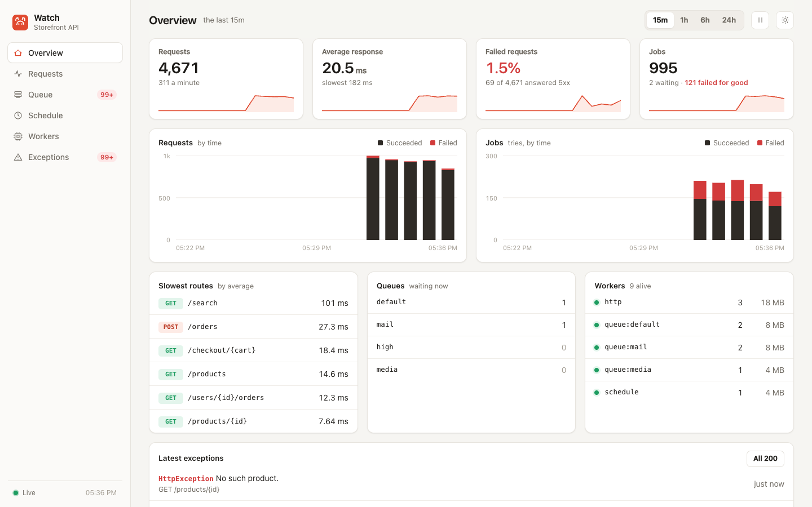
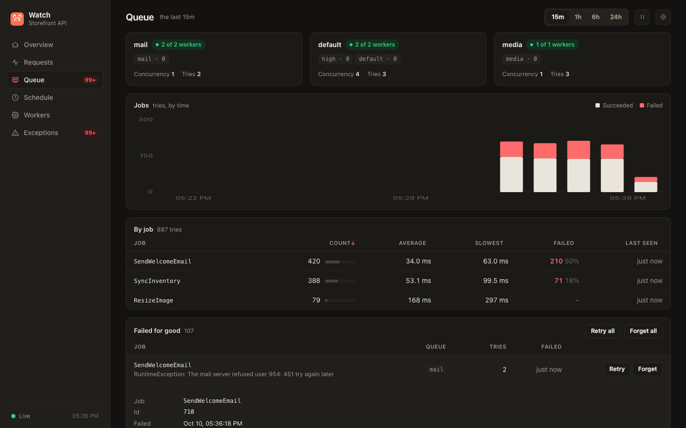

# Clockwerk

A dashboard for an application on [Crab framework 0.6](https://github.com/crabphp/framework). One page shows how it is running: requests by route, the queue and its supervisors, scheduled tasks, the worker processes, and the exceptions thrown.



Use it to answer, without opening a terminal: is everything up, what is slow, what is failing, is the queue keeping up, did last night's task run.

## Installation

```sh
composer require crabphp/clockwerk
```

Add the dashboard plugin after the queue and schedule plugins, if you use them, so it records their jobs and tasks, and before your own:

```php
// app.php
use App\Setup;
use Crab\App;
use Crab\Clockwerk\ClockwerkPlugin;
use Crab\Queue\QueuePlugin;
use Crab\Schedule\SchedulePlugin;

return App::configure(__DIR__)
    ->withPlugins([
        QueuePlugin::class,       // optional
        SchedulePlugin::class,    // optional
        ClockwerkPlugin::class,
    ])
    ->withSetup(Setup::class)
    ->create();
```

Database and events are core plugins. Queue and schedule are optional in framework 0.6; leave either out if the application does not use it. Configure the application's database, create the dashboard's tables, and say who may open it:

```sh
php cua clockwerk:install
php cua migrate
```

```php
// config/clockwerk.php
return ['token' => env('CLOCKWERK_TOKEN')];
```

Start the application with `php cua start`, then open `/clockwerk` and enter the token. A link with `/clockwerk?token=<your token>` also works: the page keeps the token for the browser tab and removes it from the address bar. Entering it on the page avoids putting it in a server or proxy access log. Use HTTPS for remote access.

> [!WARNING]
> The dashboard shows routes, job data and stack traces. What it shows is closed to everyone until `clockwerk.token` or `clockwerk.middleware` is set. The page itself is an empty shell that holds nothing of your application, and with the token it loads for anyone; middleware of your own guards the page too.

## What it shows

| Page | |
| --- | --- |
| **Overview** | Requests, response time, failures and jobs at a glance, with the slowest routes, what waits in each queue, the workers alive and the latest exceptions |
| **Requests** | Every route: how often it was asked for, its average and slowest answer, and how often it failed |
| **Queue** | Whether it is keeping up and where it is not; each queue's pending, processing, delayed, completed and failed jobs, its longest wait and its workers; every job class. Sub-pages list the jobs standing in a state one by one (pending, processing, delayed), the latest tries with how each ended, and the failed jobs, which you can retry or forget |
| **Schedule** | Every scheduled task: when it runs, when it runs next, how it has run and whether it is failing |
| **Workers** | Every worker process, HTTP, queue and scheduler: how long it has been up, its memory and how much it has handled |
| **Exceptions** | What requests, jobs and tasks threw, each with where it came from and its trace |

The range at the top, from 15 minutes to 24 hours, applies to recorded counts, recent tries and exceptions. Queue contents, failed jobs, workers and the next scheduled runs show the current state. The page checks for updates every five seconds and waits for an outstanding request before polling again. Pause stops automatic polling; a request already in progress can still finish.



`php cua clockwerk:status` prints the same numbers in short. `--minutes=60` selects a whole number from 5 to 1440; the default is 60. A successful exit means the dashboard was read, not that every worker or queue is healthy. The [HTTP API](docs/api.md) documents the state and job actions.

## Configuration

| Setting | Default | |
| --- | --- | --- |
| `clockwerk.path` | `/clockwerk` | Where the dashboard is |
| `clockwerk.token` | `null` | The secret that opens it, given as `?token=...` or `Authorization: Bearer ...` |
| `clockwerk.middleware` | `[]` | Middleware of your own to guard it, in place of the token |
| `clockwerk.name` | `Crab` | Your application's name, shown on the page |
| `clockwerk.table` | `clockwerk` | What its three tables' names start with; letters, digits and underscores, starting with a letter or underscore |
| `clockwerk.database` | `null` | The name of the database they are in; the default one when null |
| `clockwerk.interval` | `5.0` | Seconds between two writes of a worker's counts |
| `clockwerk.keep` | `24` | Hours what was recorded is kept |
| `clockwerk.hide` | `password`, `passwd`, `secret`, `token`, `api_key`, `apikey`, `authorization`, `cookie` | Job fields whose names contain one of these words are shown as `(hidden)`, at any depth |

### A database of its own

To keep the dashboard's tables apart from your application's, name one of your configured databases:

```php
// config/database.php
return [
    'default' => 'main',
    'connections' => [
        'main' => ['driver' => 'sqlite', 'database' => storage_path('database.sqlite')],
        'metrics' => [
            'driver' => 'sqlite',
            'database' => storage_path('metrics.sqlite'),
            'migrations' => dirname(__DIR__) . '/database/metrics',
        ],
    ],
];

// config/clockwerk.php
return ['database' => 'metrics'];
```

```sh
php cua clockwerk:install
php cua migrate --database=metrics
```

The migration is written among that database's, and everything the dashboard records goes there.

### Guarding it your own way

To let in your own administrators, name application middleware that authenticates and authorizes them. It replaces the dashboard token guard:

```php
// config/clockwerk.php
use App\Http\AuthenticateAdmin;

return ['middleware' => [AuthenticateAdmin::class]];
```

Retrying and forgetting jobs requires `Content-Type: application/json`. Browser requests must come from the same origin, including its scheme and port. Behind a proxy that terminates HTTPS, set `app.url` to the public application URL for browsers that do not send `Sec-Fetch-Site`. Command-line clients may omit browser origin headers and must still authenticate. The dashboard cannot be embedded in a frame and sends no referrer.

## What it costs

- **On a request:** one middleware that reads the clock twice and adds to a counter in memory. Nothing is written while a request, a job or a task runs.
- **Every few seconds:** each worker writes its counts and says it is alive. It finishes one write before starting another. Workers own separate counter rows; database locking and connection waits can still delay a write.
- **In the database:** one row per worker, per route or job, per minute it was active, kept for `clockwerk.keep` hours and then deleted.

## What to know

- **Counts are by the minute** and reach the page within `clockwerk.interval` seconds.
- **A 4xx an action chose is not a failure.** `HttpException(404)` is counted as a request and not as an error; a `500`, or anything else thrown, is.
- **Requests for no route** are grouped by method under `(no route)`. Unmatched extension methods share `OTHER (no route)`, so invented methods cannot create an unlimited number of counter names.
- **Failed jobs:** up to 200 are listed, with secret fields replaced by `(hidden)`. Known secret values of four bytes or more are also removed from job errors, including URL-encoded forms. This is best-effort redaction; exception text can still contain sensitive information. Traces carry no call arguments.
- **Recent tries:** each worker keeps at most 25 between writes; the page reads the latest 100 recorded tries. Counts include every try even when its detail was omitted.
- **When a write fails** its pending snapshot is discarded. Current-minute counters can appear in a later successful write; exception and job details from the failed write are lost. Retention is enforced periodically, not at an exact expiry time.
- **A worker that is killed** takes its unwritten counts with it. The page removes a worker after three intervals plus up to three seconds without a heartbeat. A final write during orderly shutdown is best effort too, particularly with an asynchronous store.
- **Queue worker counts** are inferred from configured supervisors and worker group names. A separate `queue:work --queue=...` override is not advertised in heartbeats, so the page cannot identify that override's queues.
- **A task with no possible next date** shows “No next run”; other dashboard views remain available. The schedule also shows `onOneServer()` and `withoutOverlapping()`.
- **Jobs and tasks use the default events plugin**, which is registered before the queue and schedule. Requests are always recorded.
- **The page is one file** with its styles and script inside it. It loads nothing from anywhere else.

## How it is built

- `Http\RecordRequests` is middleware inside the error handler; it names each request after its route.
- The framework's `JobRan` and `TaskRan` events feed jobs and tasks to the same `Recorder`.
- `Recorder` counts in memory, one per worker, and a timer of the worker writes to the `Store`.
- `Dashboard` adds the workers' counts up and puts them beside what the queue and the schedule say of themselves now.
- `Store` is an interface with one implementation, `DatabaseStore`. To keep the numbers elsewhere, implement it and bind it after the plugin.

## Tests

Install development dependencies with `composer install`. The suite uses SQLite and Node.js for the shipped dashboard script; without Node.js, its JavaScript cases are skipped. No external service is required. See [Contributing](CONTRIBUTING.md) for format, lint and CI checks.

```sh
composer test
```
