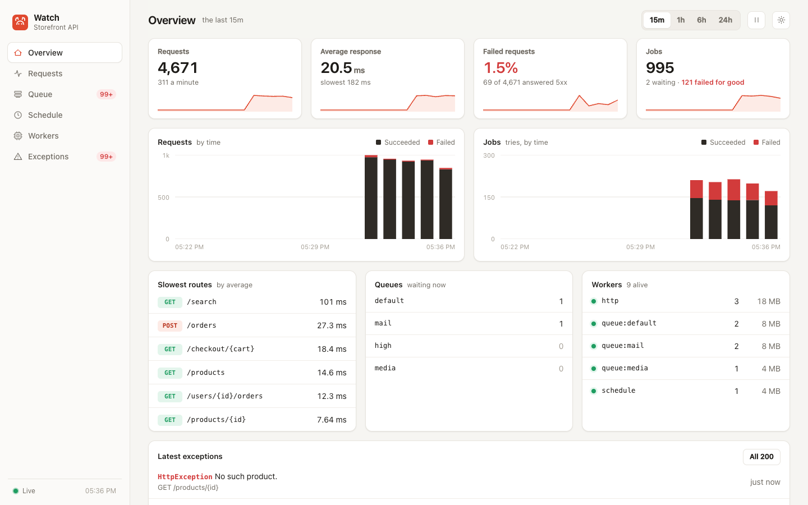
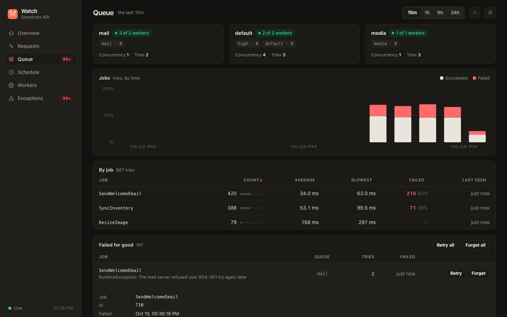

# Clockwerk

A dashboard for an application on the [Crab framework](../framework). One page shows how it is running: requests by route, the queue and its supervisors, scheduled tasks, the worker processes, and the exceptions thrown.



Use it to answer, without opening a terminal: is everything up, what is slow, what is failing, is the queue keeping up, did last night's task run.

## Installation

```sh
composer require crabphp/clockwerk
```

Register the provider after the framework's, and before your own:

```php
// app.php
use Crab\Clockwerk\ClockwerkProvider;

->withProviders([
    DatabaseProvider::class,
    EventsProvider::class,       // for jobs and scheduled tasks
    QueueProvider::class,
    ScheduleProvider::class,
    ClockwerkProvider::class,
    AppProvider::class,
])
```

Create its tables, and say who may open it:

```sh
php cua clockwerk:install
php cua migrate
```

```php
// config/clockwerk.php
return ['token' => env('CLOCKWERK_TOKEN')];
```

Then open `/clockwerk?token=<your token>`. The token is kept for the browser tab and taken out of the address bar. Open `/clockwerk` without it and the page asks for it.

> [!WARNING]
> The dashboard shows routes, job data and stack traces. What it shows is closed to everyone until `clockwerk.token` or `clockwerk.middleware` is set. The page itself is an empty shell that holds nothing of your application, and with the token it loads for anyone; middleware of your own guards the page too.

## What it shows

| Page | |
| --- | --- |
| **Overview** | Requests, response time, failures and jobs at a glance, with the slowest routes, what waits in each queue, the workers alive and the latest exceptions |
| **Requests** | Every route: how often it was asked for, its average and slowest answer, and how often it failed |
| **Queue** | Whether it is keeping up and where it is not; each queue's pending, processing, delayed, completed and failed jobs, its longest wait and its workers; every job class. Sub-pages list the jobs standing in a state one by one (pending, processing, delayed), the latest tries with how each ended, and the failed jobs, which you can retry or forget |
| **Schedule** | Every scheduled task: when it runs, when it runs next, how it has run and whether it is failing |
| **Workers** | Every worker process, HTTP, queue and scheduler: how long it has been up, its memory and how much it has handled |
| **Exceptions** | What requests, jobs and tasks threw, each with where it came from and its trace |

The range at the top, from 15 minutes to 24 hours, applies to every page. The page refreshes itself every five seconds; the pause button holds it still.



`php cua clockwerk:status` prints the same numbers in short, for a terminal or a health script.

## Configuration

| Setting | Default | |
| --- | --- | --- |
| `clockwerk.path` | `/clockwerk` | Where the dashboard is |
| `clockwerk.token` | `null` | The secret that opens it, given as `?token=...` or `Authorization: Bearer ...` |
| `clockwerk.middleware` | `[]` | Middleware of your own to guard it, in place of the token |
| `clockwerk.name` | `Crab` | Your application's name, shown on the page |
| `clockwerk.table` | `clockwerk` | What its three tables' names start with |
| `clockwerk.database` | `null` | The name of the database they are in; the default one when null |
| `clockwerk.interval` | `5.0` | Seconds between two writes of a worker's counts |
| `clockwerk.keep` | `24` | Hours what was recorded is kept |
| `clockwerk.hide` | `password`, `passwd`, `secret`, `token`, `api_key`, `apikey`, `authorization`, `cookie` | A failed job's fields whose names contain one of these words are shown as `(hidden)` |

### A database of its own

To keep the dashboard's tables apart from your application's, name one of your configured databases:

```php
// config/database.php
'default' => 'main',
'connections' => [
    'main' => ['dsn' => env('DB_DSN'), 'migrations' => dirname(__DIR__) . '/database/migrations'],
    'metrics' => ['dsn' => env('METRICS_DSN'), 'migrations' => dirname(__DIR__) . '/database/metrics'],
],

// config/clockwerk.php
return ['database' => 'metrics'];
```

```sh
php cua clockwerk:install
php cua migrate --database=metrics
```

The migration is written among that database's, and everything the dashboard records goes there.

### Guarding it your own way

To let in your own administrators, name the middleware that does so, and the token is no longer asked for:

```php
// config/clockwerk.php
return ['middleware' => [TokenAuth::class, AdminsOnly::class]];
```

Retrying and forgetting jobs is accepted only from the dashboard's own page: a request must be JSON and must not come from another site. So a cookie that logs your administrators in cannot be used by another site to delete jobs behind their backs.

## What it costs

- **On a request:** one middleware that reads the clock twice and adds to a counter in memory. Nothing is written while a request, a job or a task runs.
- **Every few seconds:** each worker writes its own counts for the current minute, a handful of rows, and says it is alive. Workers write only their own rows, so they never wait on one another.
- **In the database:** one row per worker, per route or job, per minute it was active, kept for `clockwerk.keep` hours and then deleted.

## What to know

- **Counts are by the minute** and reach the page within `clockwerk.interval` seconds.
- **A 4xx an action chose is not a failure.** `HttpException(404)` is counted as a request and not as an error; a `500`, or anything else thrown, is.
- **Requests for no route** are counted together as `(no route)`, so a scanner cannot fill the table with made-up addresses.
- **Failed jobs:** the latest 200 are listed, with the fields named in `clockwerk.hide` left out. Their exception traces carry no arguments.
- **When the database is down** the counts of that time are lost, not kept: a worker never holds more than the current minute in memory.
- **A worker that is killed** takes its last few seconds of counts with it, and leaves the list within three intervals.
- **Jobs and tasks need `EventsProvider`** registered before the queue and schedule providers. Requests are always recorded.
- **The page is one file** with its styles and script inside it. It loads nothing from anywhere else.

## How it is built

- `Http\RecordRequests` is middleware inside the error handler; it names each request after its route.
- The framework's `JobRan` and `TaskRan` events feed jobs and tasks to the same `Recorder`.
- `Recorder` counts in memory, one per worker, and a timer of the worker writes to the `Store`.
- `Dashboard` adds the workers' counts up and puts them beside what the queue and the schedule say of themselves now.
- `Store` is an interface with one implementation, `DatabaseStore`. To keep the numbers elsewhere, implement it and bind it after the provider.

## Tests

```sh
composer test
```
